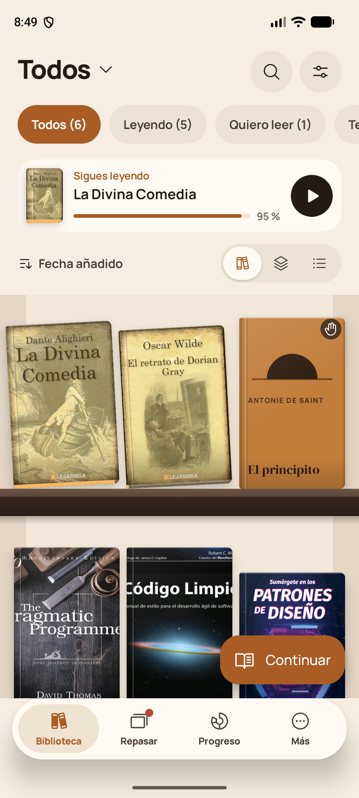
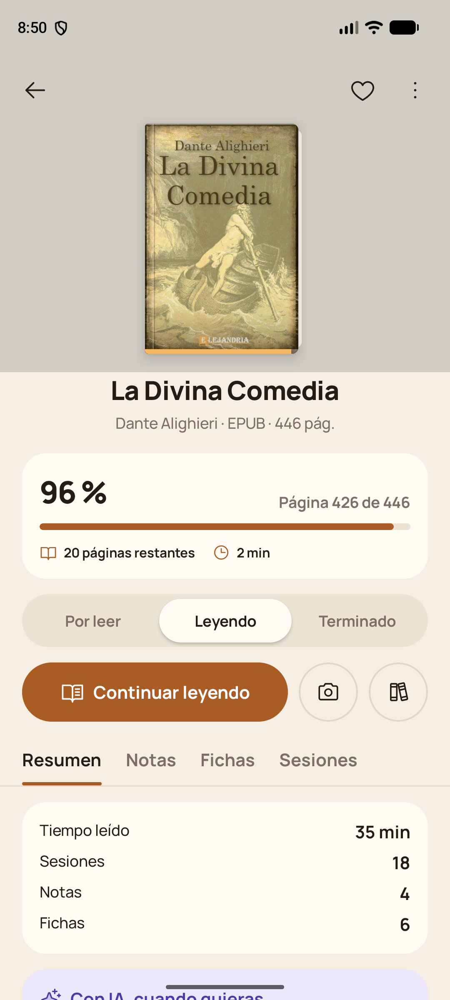
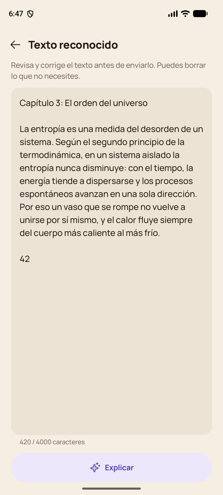
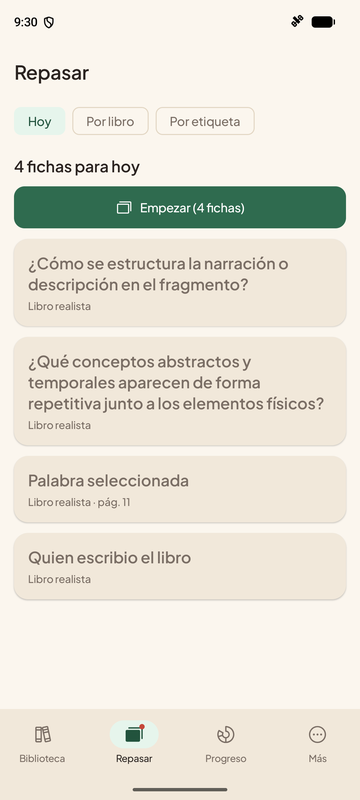
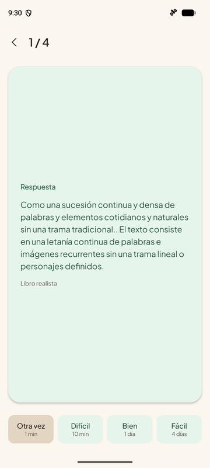
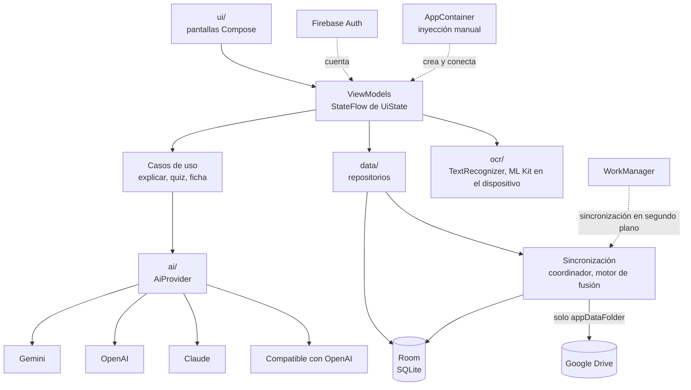

<div align="center">


# Reader

**Lee. Entiende. Recuerda.**

Un asistente de lectura para Android que explica con IA las partes difíciles<br/>
y se asegura de que no olvides lo que lees.

[English](README.md) · **Español**

[](https://github.com/Fabiann1809/reader/actions/workflows/ci.yml)


-8E75B2)


</div>

---

## Por qué Reader

Leer algo difícil casi siempre pasa igual: llegas a un párrafo que no entiendes del todo, sigues leyendo de todos modos y unos días después no lo recuerdas. Las herramientas que rodean ese momento ayudan poco:

- **Un libro de papel no se puede buscar.** Fotografiar una página deja una imagen llena de texto que no puedes copiar, corregir ni archivar.
- **Preguntarle a una IA obliga a copiar el texto a mano** en un chat, sin vínculo con el libro, la página ni lo que ya habías escrito sobre ella.
- **Las notas y los resaltados acaban dispersos** en varias apps, y casi nunca se vuelven a leer.
- **Sin repaso, gran parte de lo que lees se desvanece** en pocos días.

Reader reúne todo ese camino en un solo lugar y lo deja bajo tu control: tus propios libros, tu propia clave de IA y tus propios datos.

### La idea

Reader cierra el ciclo entre leer y recordar:

```
   Leer  ──▶  Entender  ──▶  Guardar  ──▶  Repasar  ──▶  Ponerte a prueba
     ▲                                                          │
     └──────────── lo que fallas vuelve como una ficha ◀────────┘
```

Fotografía una página de un libro de papel o selecciona texto en un libro digital. El texto se reconoce en el dispositivo, la IA lo explica con palabras sencillas (método Feynman) y tú guardas el resultado como nota y conviertes las ideas clave en fichas.

## Capturas de pantalla

<div align="center">

| Biblioteca | Libro | Captura y OCR | Repaso | Ficha |
|:---:|:---:|:---:|:---:|:---:|
|  |  |  |  |  |

</div>

## Funciones

### Biblioteca y lectura
- Vistas de **estantes, cuadrícula o lista**, con colecciones, búsqueda, orden y filtros.
- **Libros digitales** (EPUB, PDF, TXT y CBZ) que se leen dentro de la app: temas, tipos de letra, índice, marcadores y resaltados.
- **Lectura en voz alta** para EPUB y TXT, con el motor de voz del teléfono.
- También **libros de papel**: regístralos y sigue tu página, tu progreso y el tiempo que te queda.
- **Carpeta vigilada**: los libros que pongas en ella se importan solos.

### Entiende con IA
- Selecciona texto en un EPUB, marca una zona de un PDF o fotografía una página de papel.
- El **OCR** en el dispositivo (ML Kit) extrae el texto, avisa cuando no está seguro y te deja corregirlo.
- La IA **explica el pasaje con sencillez**, con analogías cotidianas, y puede volver a explicarlo con palabras más simples o con otro ejemplo.
- **«Ahora tú»**: escribe tu propia interpretación y recibe comentarios sobre ella.

### Notas
- **Notas escritas**, **explicaciones de la IA** y **notas de voz**, cada una vinculada a su libro y su página. Las notas de voz se pueden transcribir con Gemini u OpenAI; con otros proveedores la grabación se guarda igual.
- Busca en todas las notas por texto y filtra por tipo.

### Recuerda
- **Fichas** creadas a partir de notas, explicaciones, texto seleccionado o preguntas falladas de un quiz. La IA puede sugerir la pregunta y la respuesta.
- **Repetición espaciada** (SM-2 simplificado): cada ficha vuelve poco antes de que la olvides, con un **recordatorio diario** opcional a la hora que elijas.
- **Quizzes** sobre un capítulo, un párrafo, tus fichas o tus notas; las preguntas falladas se convierten en fichas nuevas.

### Progreso
- Meta diaria de lectura, racha, gráfica semanal y libros terminados.
- Resumen por libro: tiempo leído, sesiones, notas y fichas.

### Cuenta y sincronización con Google Drive
- **Inicia sesión** con correo y contraseña o con Google. Cada cuenta tiene su propia biblioteca: otra persona que inicie sesión en el mismo teléfono nunca ve tus libros.
- **Sincronización opcional con tu propio Google Drive.** Después de iniciar sesión, Reader te ofrece guardar la biblioteca en Drive; también puedes activarla o apagarla en **Más → Cuenta**. Libros, portadas, notas, fichas, marcadores y progreso de lectura se mantienen al día entre dispositivos, y gana el cambio más reciente.
- **Acceso limitado.** Reader pide solo el ámbito de datos de aplicación de Drive: una carpeta oculta que pertenece a la app. No puede leer ni listar nada más de tu Drive.
- **Automática o manual.** Los cambios se suben en segundo plano unos segundos después de hacerlos, opcionalmente solo con Wi-Fi, y **Sincronizar ahora** fuerza una pasada.
- **Cerrar sesión es seguro.** Reader primero guarda todo en Drive y luego limpia el teléfono. Si vuelves a iniciar sesión con la misma cuenta, se restaura la biblioteca, con una pantalla de carga mientras se descarga. Las cuentas sin datos en Drive pasan directo a una biblioteca vacía.
- **Sin servidores propios.** Tus datos viven en tu teléfono y en tu propio Drive.

## Instalación

1. Descarga el último `Reader-x.y.z.apk` desde la página de [**Releases**](https://github.com/Fabiann1809/reader/releases), o [compílalo tú mismo](#compilar-desde-el-código-fuente).
2. Ábrelo en tu teléfono. Android te pedirá que **permitas instalar apps de este origen**: permítelo.
3. Abre **Reader**, inicia sesión, añade tu primer libro y empieza a leer.

> Requiere **Android 8.0 (API 26)** o superior.

## Configura tu clave de IA

Reader funciona con tu propia clave de API (*bring your own key*). Elige el proveedor en **Más → Ajustes → Proveedor de IA**; cada proveedor guarda su propia clave y su propio modelo.

| Proveedor | Notas |
|---|---|
| **Google Gemini** | Clave gratuita en [aistudio.google.com/apikey](https://aistudio.google.com/apikey): inicia sesión con tu cuenta de Google y pulsa **Create API key**. |
| **OpenAI** | Clave en [platform.openai.com/api-keys](https://platform.openai.com/api-keys). La API se cobra aparte de ChatGPT. |
| **Claude (Anthropic)** | Clave en [console.anthropic.com/settings/keys](https://console.anthropic.com/settings/keys). La API se cobra aparte de Claude.ai. |
| **Otro** | Cualquier servicio compatible con la API de chat de OpenAI (OpenRouter, Groq, DeepSeek...): escribe su dirección base con `https` y el nombre del modelo. |

Luego pega la clave en **Clave de API**, pulsa **Guardar clave** y usa **Probar clave** para comprobarla.

> La clave se guarda **cifrada** en tu teléfono (Android Keystore) y solo se envía a tu proveedor de IA cuando pides una explicación, un quiz o una transcripción. Nunca se sincroniza.

Todo lo demás (biblioteca, lector, OCR, notas, repasos) funciona sin clave.

## Compilar desde el código fuente

**Requisitos:** Android Studio (reciente), JDK 17 o superior y el SDK de Android (compile SDK 37).

```bash
git clone https://github.com/Fabiann1809/reader.git
cd reader
./gradlew assembleDebug        # app/build/outputs/apk/debug/app-debug.apk
./gradlew testDebugUnitTest    # pruebas unitarias
```

### APK de release firmado

1. Crea un keystore (guárdalo, con su contraseña, en un lugar seguro y **fuera del repositorio**):
   ```bash
   keytool -genkeypair -keystore ~/keystores/reader-release.jks -alias reader \
     -keyalg RSA -keysize 4096 -validity 10000
   ```
2. Crea `keystore.properties` en la raíz del proyecto (git lo ignora):
   ```properties
   storeFile=/ruta/absoluta/a/reader-release.jks
   storePassword=tu-contraseña
   keyAlias=reader
   keyPassword=tu-contraseña
   ```
3. Compila:
   ```bash
   ./gradlew assembleRelease      # app/build/outputs/apk/release/app-release.apk
   ```

Sin `keystore.properties`, el APK de release se genera sin firmar. Los builds de release se minimizan y reducen con R8.

## Tecnologías

| Capa | Tecnología |
|---|---|
| Lenguaje e interfaz | Kotlin, Jetpack Compose, Material 3, Navigation Compose |
| Arquitectura | MVVM (ViewModel + `StateFlow`), repositorios, inyección manual (`AppContainer`) |
| Almacenamiento | Room, DataStore |
| Lector | Readium Kotlin Toolkit (EPUB, PDF con PDFium) |
| Cámara y OCR | CameraX, ML Kit Text Recognition (en el dispositivo) |
| IA | Gemini, OpenAI, Claude y servicios compatibles con OpenAI, sobre OkHttp + kotlinx.serialization, detrás de la interfaz `AiProvider` |
| Trabajo en segundo plano | WorkManager |
| Cuenta | Firebase Authentication (correo y Google) |
| Sincronización | API REST de Google Drive (carpeta de datos de la app) sobre OkHttp, con un motor de fusión puro |

```
io.github.fabiann1809.reader
├── data/   entidades Room, DAOs y repositorios
├── ai/     AiProvider, una implementación por servicio y los prompts
├── ocr/    envoltorio del reconocimiento de texto de ML Kit
├── ui/     pantallas Compose y ViewModels, un paquete por función
└── util/   pequeñas utilidades compartidas
```

## Arquitectura



Los composables nunca tocan los repositorios: observan un ViewModel, que llama a repositorios y casos de uso. Los repositorios son el único punto de entrada a Room y a la sincronización, el reconocimiento de texto está detrás de la interfaz `TextRecognizer` y toda llamada a un modelo pasa por `AiProvider`. Un solo `AppContainer`, propiedad de la clase de aplicación, crea y conecta todo.

## Decisiones técnicas

| Decisión | Por qué |
|---|---|
| **Kotlin nativo y Jetpack Compose**, no Flutter ni React Native | La cámara, el OCR en el dispositivo, el Keystore y la síntesis de voz son APIs de Android. Un puente multiplataforma añade fricción, y la app solo apunta a Android. |
| **Trae tu propia clave (BYOK)**, sin backend | No hay servidor que mantener ni costo para el autor. La clave nunca pasa por un tercero. |
| **Interfaz `AiProvider`** con cuatro implementaciones | Gemini, OpenAI, Claude y cualquier servicio compatible con OpenAI se pueden intercambiar sin tocar la interfaz de usuario. |
| **OCR en el dispositivo** (ML Kit) | Es gratis, funciona sin conexión y la foto de la página se queda en el teléfono. Solo se envía el texto reconocido, después de que el usuario lo corrige. |
| **Local primero (Room)**, sincronización opcional con Drive | Los datos viven en el teléfono. La sincronización es opcional y se limita a la carpeta oculta de la app en Drive. |
| **MVVM con inyección de dependencias manual** (`AppContainer`), sin Hilt | También es un proyecto de aprendizaje: sin magia de frameworks, y las conexiones se ven en un solo lugar. |
| **SM-2 simplificado** para las fichas | Un algoritmo conocido, fácil de cubrir con pruebas unitarias y suficiente para este caso de uso. |
| **Readium** para EPUB y PDF | Ya resuelve la selección de texto, los localizadores, los temas y la lectura en voz alta, así que no hay que escribir un motor de lectura. |

### La clave de API
La clave se guarda cifrada con el Android Keystore, por separado para cada proveedor, y nunca se escribe en el repositorio, en los registros ni en los mensajes de excepción. Solo se envía al proveedor que el usuario eligió, cuando el usuario pide algo, y no forma parte de la sincronización con Drive. Toda llamada a un modelo pasa por `AiProvider`, así que el resto de la app no sabe qué servicio responde. Los esquemas de salida estructurada de los demás proveedores se convierten a partir de los de Gemini.

### Sincronización sin servidor
Reader no tiene backend. La sincronización usa la API REST de Drive sobre OkHttp y solo el ámbito `appDataFolder`, una carpeta oculta que pertenece a la app, así que no puede leer ni listar nada más del Drive del usuario. Cada registro lleva un id y una marca de tiempo `updatedAt`, mantenida por triggers de SQLite, y los borrados se guardan como lápidas (*tombstones*). El motor de fusión es una función pura: gana el cambio más reciente, y un borrado gana un empate. Como no depende de Android, lo cubren pruebas unitarias normales, y una prueba instrumentada sincroniza dos dispositivos simulados a través de una nube falsa. Cada cuenta de Reader tiene su propio prefijo en la carpeta, así que dos cuentas en un mismo teléfono nunca ven la biblioteca de la otra.

## Licencia

[MIT](LICENSE) © 2026 Fabiann1809
