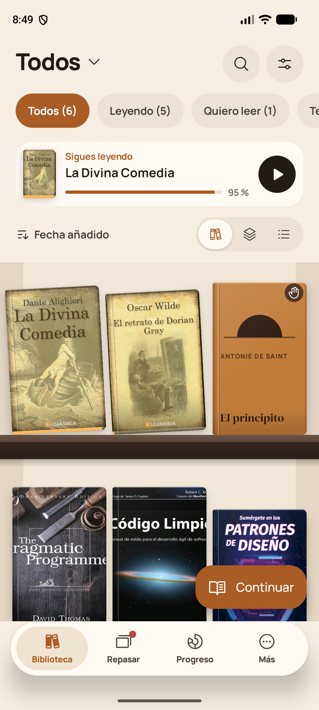
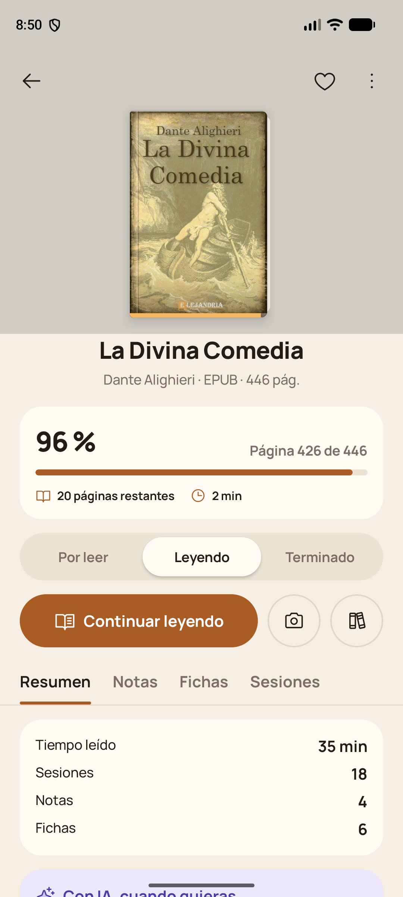
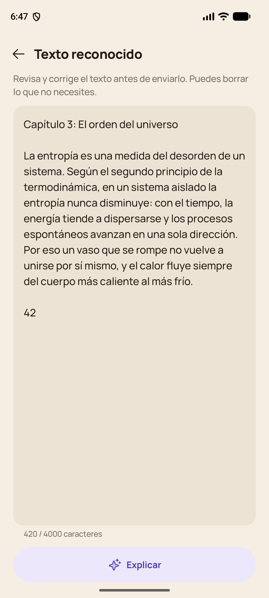
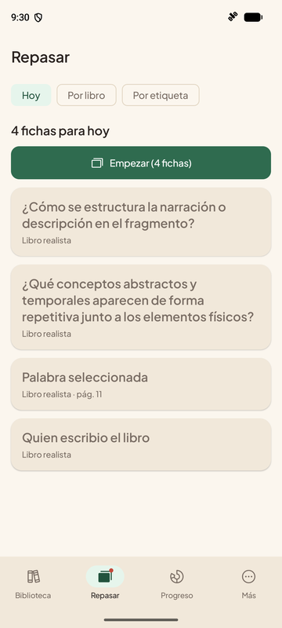
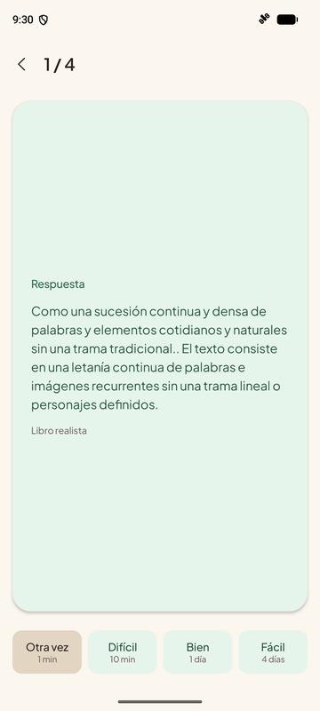
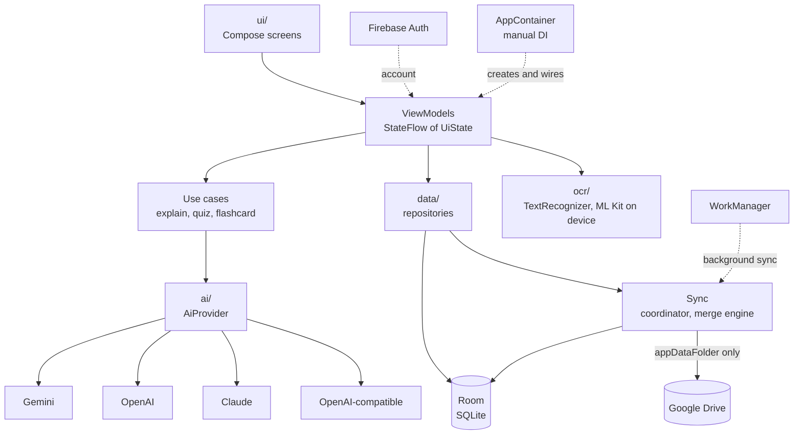

<div align="center">


# Reader

**Read. Understand. Remember.**

An Android reading companion that explains the hard parts with AI<br/>
and makes sure you don't forget what you read.

[](https://github.com/Fabiann1809/reader/actions/workflows/ci.yml)


-8E75B2)


</div>

---

## The idea

Most readers retain only part of what they read and forget much of it within days. Reader closes that loop:

```
   Read  ──▶  Understand  ──▶  Save  ──▶  Review  ──▶  Test yourself
     ▲                                                       │
     └───────────── what you miss comes back as a card ◀─────┘
```

Photograph a page of a paper book, or select text in an ebook. The text is recognized on the device, the AI explains it in plain words (Feynman method), and you save the result as a note and turn the key ideas into flashcards.

## Screenshots

<div align="center">

| Library | Book | Capture and OCR | Review | Flashcard |
|:---:|:---:|:---:|:---:|:---:|
|  |  |  |  |  |

</div>

## Features

### Library and reading
- **Shelves, grid or list** views, with collections, search, sorting and filters.
- **Ebooks** (EPUB, PDF, TXT and CBZ) read inside the app: themes, fonts, table of contents, bookmarks and highlights.
- **Read aloud** for EPUB and TXT, using the voice engine of the phone.
- **Paper books** too: register them and track your page, progress and remaining time.
- **Watched folder**: books placed in it are imported automatically.

### Understand with AI
- Select text in an EPUB, mark an area of a PDF, or take a photo of a paper page.
- On-device **OCR** (ML Kit) extracts the text, warns when it is not confident, and lets you correct it.
- The AI **explains the passage simply**, using everyday analogies, and can explain it again in simpler words or with another example.
- **"Ahora tú"**: write your own interpretation and receive feedback on it.

### Notes
- **Written notes**, **AI explanations** and **voice notes**, each linked to its book and page. Voice notes can be transcribed with Gemini or OpenAI; with other providers the recording is still saved.
- Search every note by text and filter by type.

### Remember
- **Flashcards** created from notes, explanations, selected text or missed quiz questions. The AI can suggest the question and answer.
- **Spaced repetition** (simplified SM-2): each card returns shortly before you would forget it, with an optional **daily reminder** at the time you choose.
- **Quizzes** on a chapter, a paragraph, your cards or your notes, and missed questions become new cards.

### Progress
- Daily reading goal, streak, weekly chart and finished books.
- Per-book summary: time read, sessions, notes and cards.

### Account and Google Drive sync
- **Sign in** with email and password or with Google. Each account has its own library: another person signing in on the same phone never sees your books.
- **Optional sync with your own Google Drive.** After signing in, Reader offers to save the library to Drive; it can also be turned on or off in **Más → Cuenta**. Books, covers, notes, flashcards, bookmarks and reading progress are kept in step across devices, and the most recent change wins.
- **Limited access.** Reader requests only the Drive application-data scope: a hidden folder that belongs to the app. It cannot read or list anything else in your Drive.
- **Automatic or manual.** Changes are uploaded in the background a few seconds after they are made, optionally only on Wi-Fi, and **Sincronizar ahora** forces a pass.
- **Signing out is safe.** Reader first saves everything to Drive and then clears the phone. Signing in again with the same account restores the library, with a loading screen while it downloads. Accounts without data in Drive go straight to an empty library.
- **No servers of our own.** Your data lives on your phone and in your own Drive.

## Install

1. Download the latest `Reader-x.y.z.apk` from the [**Releases**](https://github.com/Fabiann1809/reader/releases) page, or [build it yourself](#build-from-source).
2. Open it on your phone. Android will ask you to **allow installing apps from this source**: allow it.
3. Open **Reader**, sign in, add your first book and start reading.

> Requires **Android 8.0 (API 26)** or newer.

## Set up your AI key

Reader works with your own API key (*bring your own key*). Choose the provider in **Más → Ajustes → Proveedor de IA**; each provider keeps its own key and model.

| Provider | Notes |
|---|---|
| **Google Gemini** | Free key in [aistudio.google.com/apikey](https://aistudio.google.com/apikey): sign in with your Google account and select **Create API key**. |
| **OpenAI** | Key in [platform.openai.com/api-keys](https://platform.openai.com/api-keys). The API is billed separately from ChatGPT. |
| **Claude (Anthropic)** | Key in [console.anthropic.com/settings/keys](https://console.anthropic.com/settings/keys). The API is billed separately from Claude.ai. |
| **Otro** | Any service compatible with the OpenAI chat API (OpenRouter, Groq, DeepSeek...): enter its `https` base address and model name. |

Then paste the key in **Clave de API**, select **Guardar clave** and use **Probar clave** to check it.

> The key is stored **encrypted** on your phone (Android Keystore) and is only sent to your AI provider when you ask for an explanation, a quiz or a transcription. It is never synced.

Everything else (library, reader, OCR, notes, reviews) works without a key.

## Build from source

**Requirements:** Android Studio (recent), JDK 17 or newer and the Android SDK (compile SDK 37).

```bash
git clone https://github.com/Fabiann1809/reader.git
cd reader
./gradlew assembleDebug        # app/build/outputs/apk/debug/app-debug.apk
./gradlew testDebugUnitTest    # unit tests
```

### Signed release APK

1. Create a keystore (keep it, and its password, somewhere safe and **out of the repo**):
   ```bash
   keytool -genkeypair -keystore ~/keystores/reader-release.jks -alias reader \
     -keyalg RSA -keysize 4096 -validity 10000
   ```
2. Create `keystore.properties` in the project root (it is git-ignored):
   ```properties
   storeFile=/absolute/path/to/reader-release.jks
   storePassword=your-password
   keyAlias=reader
   keyPassword=your-password
   ```
3. Build:
   ```bash
   ./gradlew assembleRelease      # app/build/outputs/apk/release/app-release.apk
   ```

Without `keystore.properties`, the release APK is built unsigned. Release builds are minified and shrunk with R8.

## Tech stack

| Layer | Technology |
|---|---|
| Language & UI | Kotlin, Jetpack Compose, Material 3, Navigation Compose |
| Architecture | MVVM (ViewModel + `StateFlow`), repositories, manual DI (`AppContainer`) |
| Storage | Room, DataStore |
| Reader | Readium Kotlin Toolkit (EPUB, PDF via PDFium) |
| Camera & OCR | CameraX, ML Kit Text Recognition (on-device) |
| AI | Gemini, OpenAI, Claude and OpenAI-compatible services over OkHttp + kotlinx.serialization, behind an `AiProvider` interface |
| Background work | WorkManager |
| Account | Firebase Authentication (email and Google sign-in) |
| Sync | Google Drive REST API (application-data folder) over OkHttp, with a pure merge engine |

```
io.github.fabiann1809.reader
├── data/   Room entities, DAOs and repositories
├── ai/     AiProvider, one implementation per service, and prompts
├── ocr/    ML Kit text recognition wrapper
├── ui/     Compose screens and ViewModels, one package per feature
└── util/   small shared helpers
```

## Architecture



Composables never touch repositories: they observe a ViewModel, which calls repositories and use cases. Repositories are the only entry point to Room and sync, text recognition sits behind the `TextRecognizer` interface, and every model call goes through `AiProvider`. One `AppContainer`, owned by the application class, creates and wires everything.

## Technical decisions

| Decision | Why |
|---|---|
| **Native Kotlin and Jetpack Compose**, not Flutter or React Native | Camera, on-device OCR, the Keystore and text-to-speech are Android APIs. A cross-platform bridge adds friction, and the app only targets Android. |
| **Bring your own key (BYOK)**, no backend | No server to run and no cost for the author. The key never passes through a third party. |
| **`AiProvider` interface** with four implementations | Gemini, OpenAI, Claude and any OpenAI-compatible service can be swapped without touching the UI. |
| **On-device OCR** (ML Kit) | Free, works offline, and the photo of the page stays on the phone. Only the recognized text is sent, after the user has corrected it. |
| **Local first (Room)**, optional Drive sync | Data lives on the phone. Sync is opt-in and limited to the app's hidden Drive folder. |
| **MVVM with manual dependency injection** (`AppContainer`), no Hilt | This is also a learning project: no framework magic, and the wiring is visible in one place. |
| **Simplified SM-2** for flashcards | A well-known algorithm, easy to cover with unit tests and enough for this use case. |
| **Readium** for EPUB and PDF | It already solves text selection, locators, themes and read aloud, so there is no reading engine to write. |

### The API key
The key is stored encrypted with the Android Keystore, kept separately for each provider, and never written to the repository, the logs or exception messages. It is only sent to the provider the user chose, when the user asks for something, and it is not part of the Drive sync. Every model call goes through `AiProvider`, so the rest of the app does not know which service answers. The structured-output schemas of the other providers are converted from the Gemini ones.

### Sync without a server
Reader has no backend. Sync uses the Drive REST API over OkHttp and only the `appDataFolder` scope, a hidden folder that belongs to the app, so it cannot read or list anything else in the user's Drive. Every record carries an id and an `updatedAt` timestamp, kept by SQLite triggers, and deletions are recorded as tombstones. The merge engine is a pure function: the most recent change wins, and a deletion wins a tie. Because it has no Android dependencies it is covered by plain unit tests, and an instrumented test syncs two simulated devices through one fake cloud. Each Reader account has its own prefix in the folder, so two accounts on one phone never see each other's library.

## License

[MIT](LICENSE) © 2026 Fabiann1809
